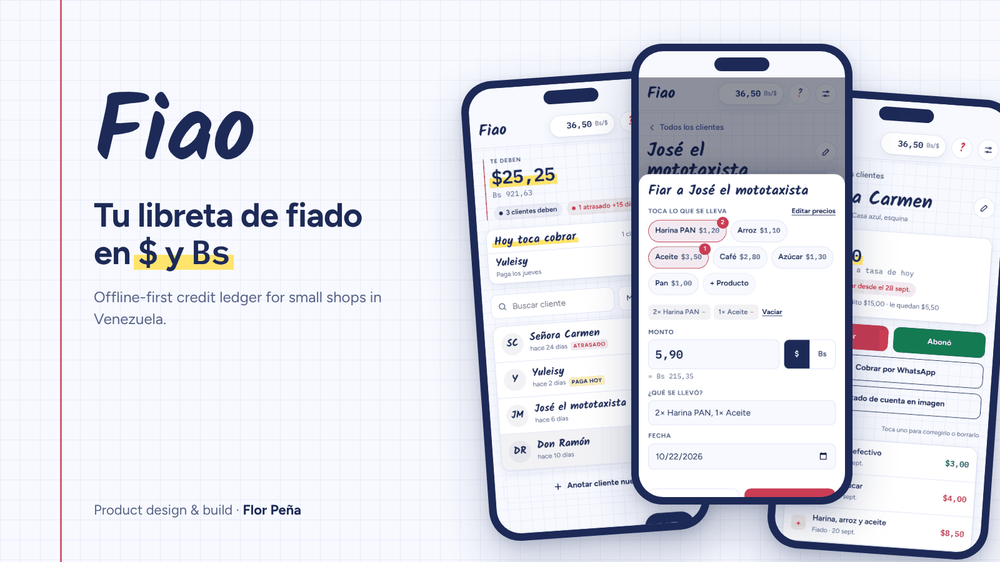
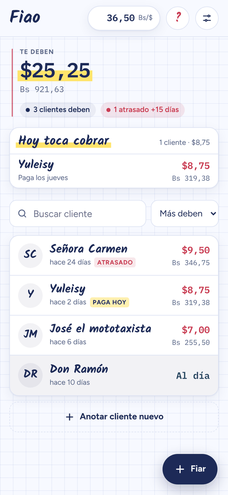
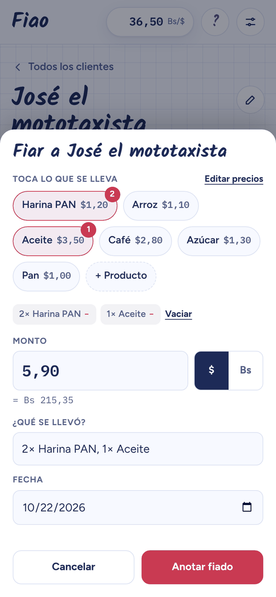
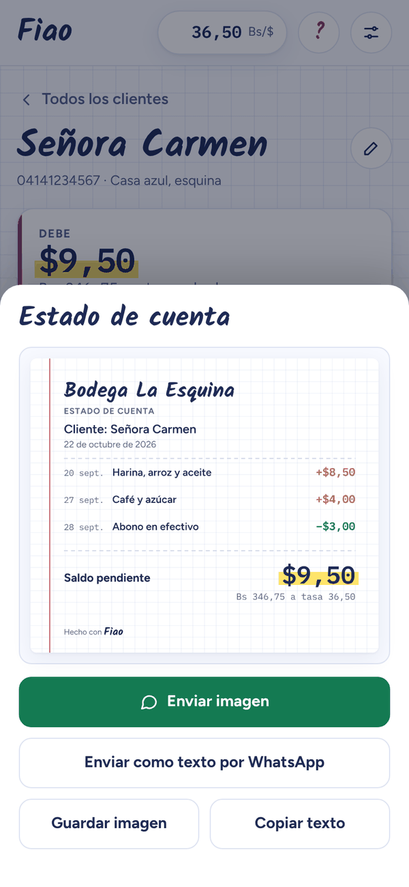
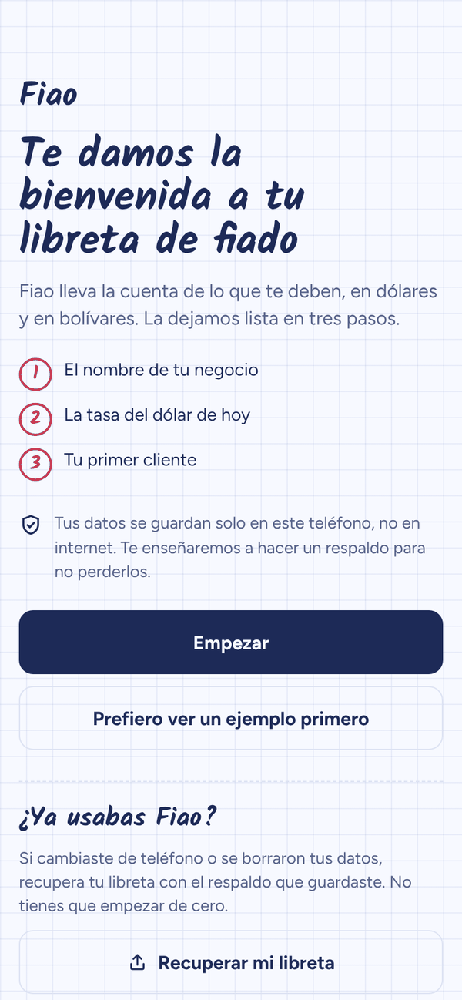
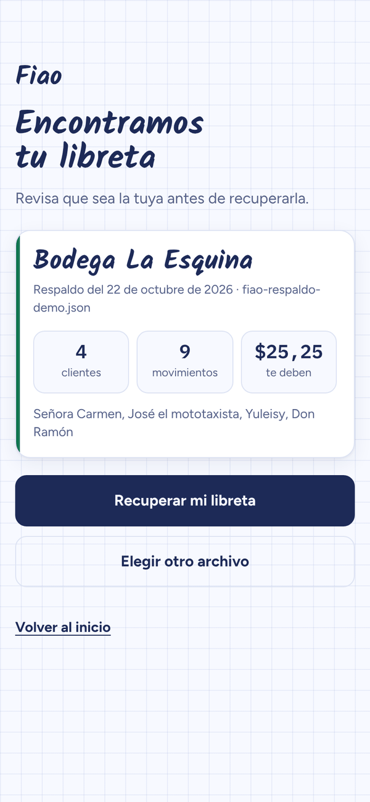
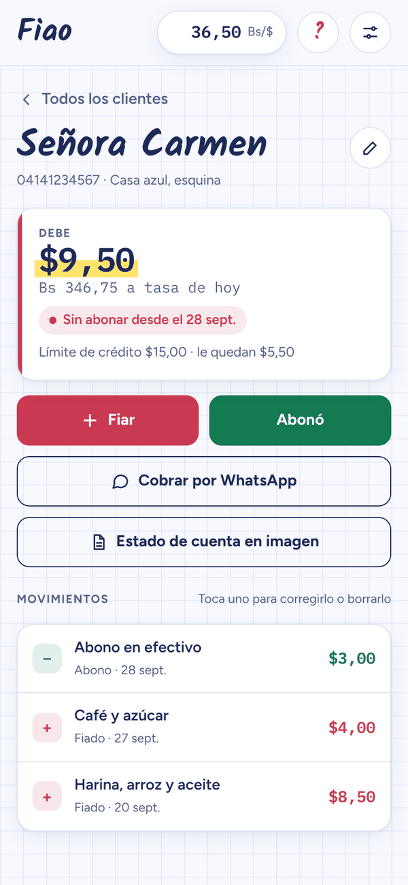
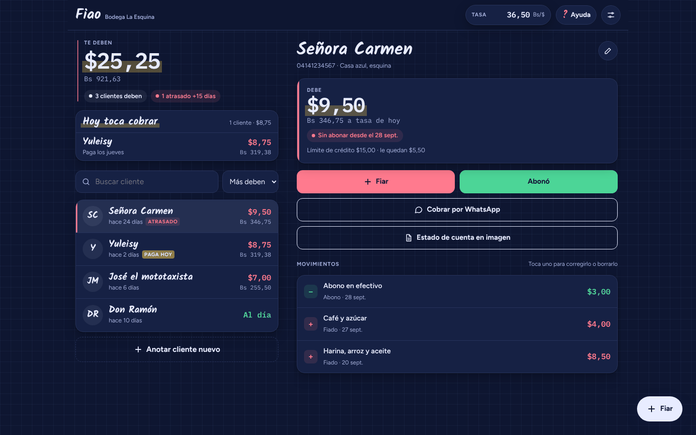

<p align="center">
  
</p>

<h1 align="center">Fiao · Libreta de fiado</h1>

<p align="center">
  <b>An offline-first credit ledger for small shops in Venezuela.</b><br>
  Track who owes what in US dollars and bolívares, charge over WhatsApp, and never lose the notebook.
</p>

<p align="center">
  <a href="https://libretadefiao.vercel.app"><b>Open the app →</b></a>
  &nbsp;·&nbsp; <a href="#resumen-en-español">Resumen en español</a>
  &nbsp;·&nbsp; Product design &amp; build by <a href="https://github.com/flormpecasique">Flor Peña</a>
</p>

<p align="center">
  
  
  
  
</p>

---

## The problem

In Venezuelan neighbourhood shops (*bodegas*), selling on credit — *fiar* — is how many families get through the month. It is tracked in a paper notebook, and that notebook breaks in three ways:

| Pain | What actually happens |
|---|---|
| **Two currencies, one moving rate** | Prices live in dollars, people pay in bolívares, and the exchange rate changes every day. Owner and customer argue about how much is really owed. |
| **No proof** | "I didn't take that." Without a record the customer can see, collecting becomes personal and awkward. |
| **Fragile records** | Notebooks get wet, lost or torn. Power and internet cuts make most apps unreliable. |

Typical ledger apps assume one currency, a stable connection and a sign-up flow. A shop owner needs something that opens in seconds, with one hand, behind the counter.

## The solution

A web app that installs like a native one and works without internet. No account, no server: the ledger lives on the phone.

<table>
  <tr>
    <td width="33%"></td>
    <td width="33%"></td>
    <td width="33%"></td>
  </tr>
  <tr>
    <td><b>See who owes what.</b> Totals in $ and Bs at today's rate, overdue customers flagged, and a "who pays today" list.</td>
    <td><b>Record credit in three taps.</b> Pick the customer, tap the products, done. Total and note fill themselves.</td>
    <td><b>End the arguments.</b> A clean statement or receipt as an image, ready for WhatsApp.</td>
  </tr>
</table>

**Features**

- Balances in **USD and bolívares** with the shop's own daily rate; credit entered in Bs is stored in USD at that day's rate so it keeps its value.
- **Quick credit** with frequent products and prices; the most used ones come first.
- **Account statements and payment receipts as images** (drawn on the device) or as text, sent to the customer's WhatsApp.
- **Payment day** per customer and a **"Hoy toca cobrar"** list; optional **credit limit** that warns instead of blocking.
- **Overdue** customers (15+ days without paying) highlighted.
- **Undo** on every action; tap any entry to edit amount, currency, note or date.
- **Backups** to a file, and **restore from the welcome screen** on a new phone.
- **Works offline**, installs to the home screen, **large-text mode**, light and dark themes.

## Design decisions

Each of these came from asking what goes wrong for a shop owner, rather than from a feature list.

**1. Onboarding instead of sample data.** The first version opened with sample customers, which are easy to mistake for real ones and write over. Now a three-step welcome asks for the business name, today's rate and the first real customer, then lands on that customer with the next action pointed out. The sample data is still one tap away for the curious.

**2. "Undo" instead of "Are you sure?".** Confirmation dialogs tend to get tapped through without reading. Every action happens immediately and offers *Deshacer* for a few seconds: faster for the usual case, safer for the mistake.

**3. Designed for the counter, not the desk.** The most repeated action is recording credit, so it has a floating button on every screen, a customer picker that doesn't pop the keyboard, and product chips that add up the total. Tap targets are at least 40 px.

**4. Honest about where the data lives.** Keeping everything on the phone is good for privacy and offline use, and it also means that clearing the browser erases the notebook. Instead of a scary banner on every visit, the risk is explained once, in plain words, next to a "back up now" button, and reminders arrive when there is something to lose (after 10 entries or 7 days). The app also asks the browser for persistent storage.

**5. Recovery where people actually land.** Someone who lost their data lands on the welcome screen, not in Settings. So the welcome screen offers *Recuperar mi libreta*, shows a preview of the backup (business, date, customers, total owed) and only restores after confirmation.

**6. A visual language taken from the subject.** The interface borrows from the paper notebook it replaces: squared paper, a red margin line, a yellow highlighter on the amount that matters, handwritten names.

<table>
  <tr>
    <td width="33%"></td>
    <td width="33%"></td>
    <td width="33%"></td>
  </tr>
</table>

<p align="center"></p>

## Quality

| Area | Result |
|---|---|
| Lighthouse (desktop) | 100 performance · 100 accessibility · 100 best practices · 100 SEO |
| Lighthouse (mobile) | 99–100 performance · 100 accessibility · 100 best practices · 100 SEO |
| Layout | Checked from 320 px phones to 1920 px screens, light and dark, normal and large text, with no horizontal overflow |
| Security | Strict Content Security Policy (no inline code), HTTPS only, no framing, no camera/mic/location access; all user input escaped; imported backups validated field by field |
| Privacy | No accounts, no cookies, no ledger data sent anywhere; cookie-less Vercel Web Analytics counts visits only |
| Weight | ~150 KB first load: self-hosted fonts subset to Spanish characters, no frameworks |

## How it's built

- **Vanilla HTML, CSS and JavaScript**: no framework and no runtime dependencies.
- **PWA**: service worker for offline use and a web manifest; installable on Android and iOS.
- **localStorage** for data, with a defensive loader that sanitises everything it reads.
- **Canvas** to draw receipts and statements as PNG images on the device.
- **Build step** in a short shell script that splits styles and code into cacheable files and writes the real domain into the SEO tags.
- **Hosting** on Vercel, deployed on every push to `main`.

Built with AI-assisted development (Claude). Product direction and UX decisions by Flor Peña.

---

## Resumen en español

**Fiao** es una libreta de fiado para bodegas, abastos y emprendedores en Venezuela. Lleva las deudas en **dólares y bolívares** con la tasa del día, permite **fiar con un toque** usando productos frecuentes, envía **estados de cuenta y comprobantes en imagen por WhatsApp**, avisa de los clientes **atrasados** y de quién **paga hoy**, y **funciona sin internet**. No hay registro ni servidor: los datos se guardan en el teléfono, con **respaldos** que se recuperan desde la pantalla de bienvenida.

👉 **[Abrir Fiao](https://libretadefiao.vercel.app)** · Diseño y desarrollo de producto: **[Flor Peña](https://github.com/flormpecasique)** · Las sugerencias se envían desde la propia app.

---

## Development

```
src/                 ← edit here
  app.html           ← the app (styles, markup and code)
  head.html          ← SEO, social preview, structured data
  fonts.css          ← self-hosted fonts
  sw.js              ← offline service worker
build.sh             ← builds public/ from src/ (Vercel runs it on deploy)
public/              ← what gets published (generated files + static assets)
docs/                ← images for this README
vercel.json          ← build settings, caching and security headers
```

```bash
sh build.sh                        # build public/
python3 -m http.server -d public   # preview at http://localhost:8000
```

The production domain is written into the canonical, Open Graph and sitemap tags from `VERCEL_PROJECT_PRODUCTION_URL`; set `SITE_URL` to override it. The support e-mail lives in `SUPPORT_EMAIL` inside `src/app.html`.
